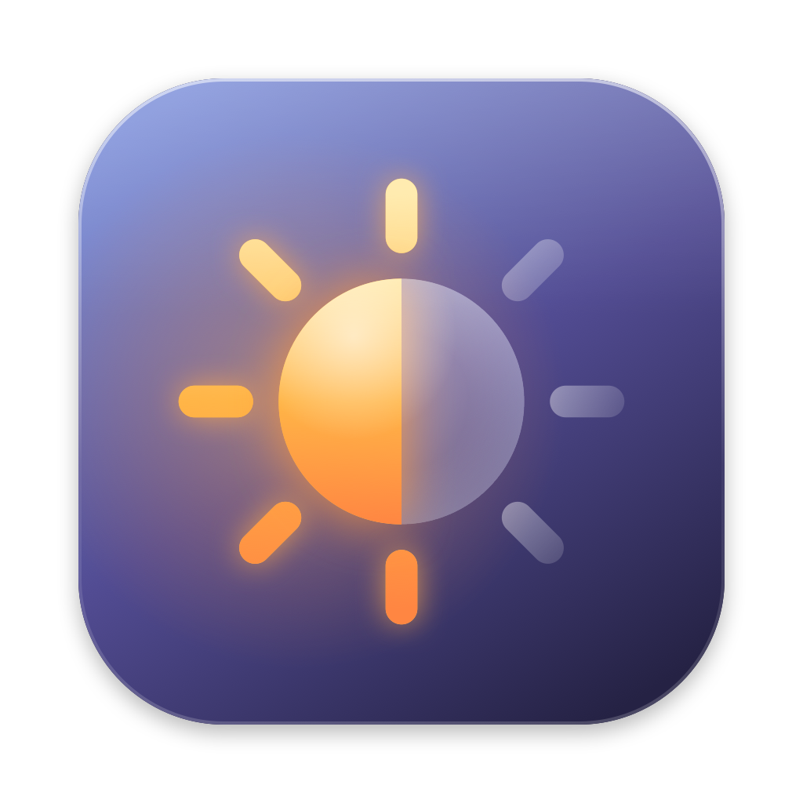

<p align="center">
  
</p>

<h1 align="center">SideLux</h1>

<p align="center">Brightness control for your external display, in a tiny menu bar app.</p>

---

## Features

- **Brightness slider** for every external display, right in the menu bar
- **Hardware control over DDC/CI** when the display is connected via USB-C, Thunderbolt or DisplayPort
- **Software dimming fallback** for connections without DDC (HDMI, many docks), so the slider always works
- **Volume control** for displays with built-in speakers (DDC connections only)
- **Keyboard shortcuts**, while your MacBook's own keys keep working as usual:

  | Shortcut | Action |
  | --- | --- |
  | `⌃ F1` / `⌃ F2` | Brightness down / up |
  | `⌃ F11` / `⌃ F12` | Volume down / up |
  | `⌃ F10` | Mute / unmute |

  With several external displays, the shortcuts adjust the one under the mouse pointer.
- Click anywhere on the slider to jump there, or scroll over it to fine-tune
- Launch at login, and a built-in check for updates from GitHub Releases
- No dependencies: one Swift file (~550 lines), a ~190 KB binary

## Requirements

- A Mac with Apple Silicon (M1 or later)
- macOS 13 Ventura or later

## Install

**Homebrew**

```bash
brew install --cask hellocket/tap/sidelux
```

Homebrew clears macOS's download quarantine, so SideLux opens right away without a warning.
Update with `brew upgrade --cask sidelux`; uninstall with `brew uninstall --cask sidelux` (add `--zap` to also remove settings).

**Or download it manually**

1. Download `SideLux-x.y.z.dmg` from the [latest release](https://github.com/hellocket/SideLux/releases/latest) and open it.
2. Drag **SideLux** onto the **Applications** shortcut. (A `.zip` is also available.)
3. Open SideLux from Applications. The first time, see below.

### First launch: "Apple could not verify SideLux…"

SideLux isn't notarized by Apple (that needs a paid developer account), so macOS blocks it the first
time you open a downloaded copy. You only have to allow it once:

1. Open SideLux. When the warning appears, click **Done** (not *Move to Trash*).
2. Open **System Settings → Privacy & Security** and scroll down to **Security**.
   You can jump straight there by running this in Terminal:
   ```bash
   open "x-apple.systempreferences:com.apple.settings.PrivacySecurity.extension"
   ```
3. Next to *"SideLux" was blocked to protect your Mac*, click **Open Anyway**, then confirm with your password or Touch ID.

SideLux opens and won't ask again. Prefer the Terminal? This does the same in one step:

```bash
xattr -dr com.apple.quarantine /Applications/SideLux.app
```

## Usage

Click the sun icon in the menu bar to show the sliders.

To use the keyboard shortcuts, turn on **Keyboard Shortcuts** in the menu and allow SideLux in
**System Settings → Privacy & Security → Accessibility**. Shortcuts start working as soon as the permission is granted.

### Hardware vs. software brightness

| Connection | Brightness | Volume |
| --- | --- | --- |
| USB-C / Thunderbolt / DisplayPort (DDC/CI) | Changes the display's backlight | ✓ |
| HDMI, many docks and adapters | Dims the picture in software | – |

Software dimming lowers the image's gamma, so blacks look slightly lifted and the backlight's power use doesn't change.
It's reset when SideLux quits. Some displays have DDC/CI turned off in their on-screen menu; turning it on there can enable hardware control.

## Build from source

```bash
git clone https://github.com/hellocket/SideLux.git
cd SideLux
./build.sh            # → build/SideLux.app
./build.sh release    # → build/SideLux-<version>.zip and .dmg, ready to attach to a release
./build.sh dmg        # rebuild only the .dmg from the existing build
./build.sh icon       # regenerate Resources/AppIcon.icns from Scripts/make-icon.swift
```

Only the Xcode Command Line Tools are needed (`xcode-select --install`).

Release builds are signed with the maintainer's "SideLux Code Signing" certificate, so the Accessibility
permission carries over between versions. Without that certificate in your keychain, `build.sh` signs ad-hoc:
macOS then treats each build as a new app, so remove the old SideLux entry under **Accessibility** and add the
new build again to keep using the shortcuts.

## Releasing an update

1. Bump `VERSION` (and `BUILD_NUMBER`) in `build.sh`.
2. Run `./build.sh release`; it prints the zip's SHA-256.
3. Create a GitHub release tagged `vX.Y.Z` and attach `build/SideLux-X.Y.Z.dmg` and `build/SideLux-X.Y.Z.zip`.
4. In [hellocket/homebrew-tap](https://github.com/hellocket/homebrew-tap), update `version` and `sha256` in `Casks/sidelux.rb`
   (a template lives in `homebrew/sidelux.rb`). Use the hash of the exact zip you uploaded: rebuilding changes it.

**Check for Updates…** compares the app's version with the latest release tag of the repository set in
`githubRepo` at the top of `Sources/main.swift`.

## Project layout

```
Sources/main.swift          the whole app
Scripts/make-icon.swift     draws the app icon
Scripts/make-dmg-background.swift   draws the DMG window background (install + first-launch steps)
Resources/AppIcon.icns      generated app icon
docs/icon.png               1024 px icon (also used by this README)
build.sh                    build, package and icon script
homebrew/sidelux.rb         Homebrew cask (published in hellocket/homebrew-tap)
```

## How it works

On Apple Silicon, SideLux talks to the display through the private `IOAVService` I²C interface and sends standard
MCCS commands (VCP `0x10` brightness, `0x62` volume). If the display never answers, it falls back to
`CGSetDisplayTransferByFormula` to dim the picture.

## License

[MIT](LICENSE)
